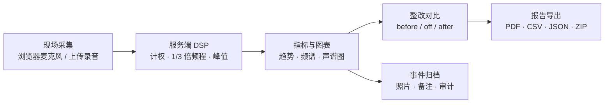
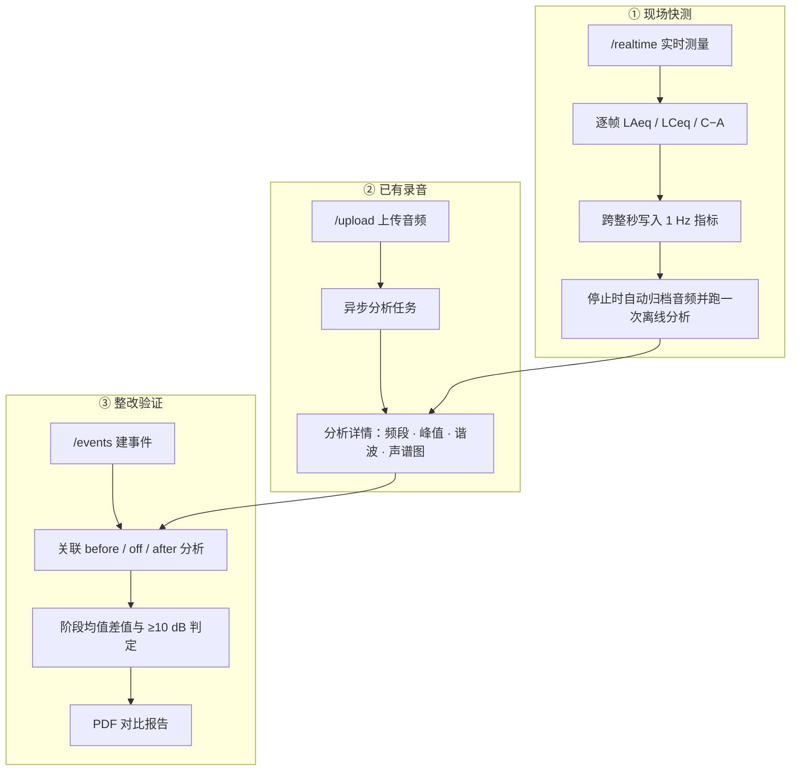
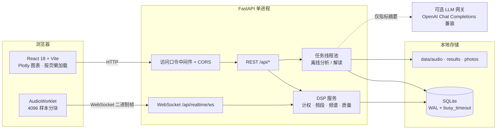

# 低频噪音 Web 平台

[](LICENSE)
[](backend/pyproject.toml)
[](frontend/package.json)
[](backend/tests)

> 用浏览器麦克风和服务端 DSP，把「听着难受、却说不清」的低频噪音，变成可对比、可导出、可追溯的数据。

**低频噪音 Web 平台**是一个可自托管的低频噪声排查工具：打开网页就能实时测量，或上传一段录音做离线分析；按 1/3 倍频程定位噪声来源频段，把整改前 / 关机 / 整改后的数据放在一起对比，最后一键导出 PDF 报告、CSV 数据包与完整 JSON。

> **English**: A self-hosted platform for low-frequency noise investigation — browser-based realtime measurement, server-side DSP (A/C/Z weighting, 1/3-octave bands, low-frequency peaks), before/off/after comparison, PDF/CSV/ZIP export, and optional LLM-assisted explanation.

---

## 它解决什么问题

低频噪音（20–200 Hz 的电机嗡鸣、水泵共振、风机低频轰鸣）有三个典型难点：

| 难点 | 常见做法的问题 | 本平台的做法 |
|------|----------------|--------------|
| 现场说不清 | 手机分贝 App 只有一个总声级，无法判断是 50 Hz 还是 125 Hz | 1/3 倍频程 + 窄带 FFT 峰值 + 谐波候选，直接指出主导频段与可能的旋转设备基频（RPM） |
| 整改无凭据 | 修完「感觉好点」，但没有任何前后数据 | 事件工作流固定 before / off / after 三阶段，自动算差值并判定是否达到 ≥10 dB 改善 |
| 过程难追溯 | 录音、截图、结论分散在聊天记录里 | 音频、结果、照片、审计日志集中落库，一键导出 PDF / CSV / JSON / ZIP |

**适合谁用**：物业与业委会的现场排查、环保/第三方检测的前期筛查、暖通水泵电梯等设备工程师的整改验证、以及受低频困扰的住户自测记录。

> 它是**排查与记录工具**，不是计量认证仪器。结果能否作为执法或验收依据，见文末[局限与免责](#局限与免责)。

---

## 一份数据的完整路径



三个入口对应三种典型场景：



---

## 三种典型用法

### ① 实时测量：到现场就能测

1. 打开 `/realtime`，授权麦克风（浏览器仅在 **HTTPS 或 localhost** 下允许采集）
2. 可选择是否**保存录音**——默认不保存，只有显式勾选才会落盘
3. 页面实时显示 LAeq / LCeq / LZeq、C−A、快速计权 LAF/LCF、累计最大值、10–500 Hz 窄带谱与 20–200 Hz 1/3 倍频程
4. 每跨过一个整秒，服务端按 A/C/Z 计权做能量积分，写入真实的 1 秒指标点
5. 停止后自动归档录音并创建一次离线分析任务，保证「实时看到的」与「报告里的」口径一致

> 网络中断或误关页面也不会白测：已授权录音且时长 ≥1 s 时会自动分段归档并在审计中标记 `interrupted`，重连后回到同一条测量记录。

### ② 离线分析：已有录音也能出结论

1. `/upload` 上传 WAV / FLAC / OGG / MP3（默认单文件上限 500 MB、分析时长上限 600 s）
2. 服务端异步跑分析：计权总级、1/3 倍频程、低频峰值、谐波候选、时间序列、声谱图、质量标志
3. 在分析详情页查看图表与指标，按需导出 CSV / JSON / PDF / ZIP
4. 失败任务可重试，排队中或计算中的任务可取消

### ③ 整改验证：ON / OFF / ON 三步对比

1. `/events` 新建噪音事件，填写位置、测点、设备、备注、标签，可上传现场照片
2. 分别把「整改前 ON」「关机 OFF」「整改后 ON」三次分析关联到同一事件
3. 事件详情自动汇总各阶段平均 LAeq，算出三组差值，并判断是否达到 **≥10 dB** 的改善阈值
4. 导出对比报告；可选让 AI 生成一段解读（默认关闭）

---

## 功能一览

| 模块 | 能力 |
|------|------|
| 测量 | 浏览器实时采集（AudioWorklet，4096 分块、ack 队列、丢帧计数）、逐帧指标、1 Hz 指标落库、断线分段恢复 |
| 分析 | A / C / Z 计权、LAeq / LCeq / LZeq / C−A、LAFmax / LCFmax / LCpeak、1/3 倍频程（Z 与 A 双口径）、10–500 Hz 窄带 FFT、低频峰值与突出度、谐波候选与 RPM 估算、STFT 声谱图、质量标志 |
| 对比 | before / off / after 阶段标记、事件阶段均值差、≥10 dB 改善判定 |
| 记录 | 噪音事件、现场照片（≤10 MB）、测点与设备信息、审计日志（操作人可追溯） |
| 报告 | PDF 排查报告、1/3 倍频程 CSV、完整结果 JSON、含原始音频的数据包 ZIP |
| 运维 | 工作台 KPI 与趋势、磁盘水位与队列状态、音频保留期清理、备份脚本、任务失败重试/取消、访问口令 |
| 可选 AI | 分析解读与事件对比解读：脱敏后仅发送指标摘要，支持缓存、取消、历史版本、人工反馈与月度 token 预算 |

---

## 架构



- 前端图表按需拆包：首屏入口 JS 只有数 kB，Plotly 只在进入图表页时加载
- 后端按单进程设计（SQLite + 线程池），启动时会把上次残留的 `queued/running` 任务重新入队
- 实时链路中的落库与写文件通过 `asyncio.to_thread` 卸载，不阻塞事件循环

---

## 快速开始

前置：Python 3.11+、Node.js 18+

**后端**

```powershell
cd backend
python -m venv .venv
.\.venv\Scripts\python.exe -m pip install -e ".[dev]"
Copy-Item .env.example .env
.\.venv\Scripts\python.exe -m uvicorn app.main:app --reload --port 8000
```

接口文档：http://127.0.0.1:8000/docs

**前端**

```powershell
cd frontend
npm install
npm run dev
```

打开 http://localhost:5173 ，`/api`（含 WebSocket）已代理到 8000 端口。

> 国内网络下 pip 安装较慢时，可追加 `-i https://pypi.tuna.tsinghua.edu.cn/simple`。

**页面一览**

| 路径 | 页面 |
|------|------|
| `/` | 工作台：KPI、最近一次测量的 1 Hz 趋势、待处理事件、系统摘要 |
| `/upload` | 测量分析：上传音频、创建任务 |
| `/realtime` | 实时测量 |
| `/events` | 噪音事件与整改对比 |
| `/audit` | 审计日志 |
| `/settings` | 隐私、校准、访问口令、AI 配置 |
| `/analyses/{id}` | 分析详情 |

---

## 指标口径速查

| 指标 | 说明 |
|------|------|
| LAeq / LCeq / LZeq | A / C / Z 计权等效声级，频域按 IEC 61672 公式施加，1 kHz 归零 |
| C−A | 低频相对权重，正值越大说明低频成分越突出 |
| LAFmax / LCFmax | 125 ms 指数计权的快速最大值 |
| LCpeak | C 计权瞬时峰值 |
| 低频占比 | 20–200 Hz 能量占全频带比例 |
| 1/3 倍频程 | 1 Hz–20 kHz 标称中心频率，Z 与 A 双口径；实时链路覆盖 20–200 Hz |
| 窄带 FFT | 10–500 Hz，Z 计权、Hann 窗，按块取峰值降采样 |
| 谐波候选 | 显著峰作基频，匹配 2X–10X 谐波，输出 RPM 与匹配分数 |
| 质量标志 | `uncalibrated`、`clipping_suspected`、`dc_offset_detected`、`digital_silence`、`mostly_silent`、`short_duration`、`multichannel_downmixed` |

未校准麦克风的全量程默认映射为 1 Pa（≈94 dB SPL），此时结果仅为**相对值**；用 94/114 dB @ 1 kHz 校准器可在实时测量页保存单点校准修正量。

---

## 数据与隐私

- **默认不保存录音**：实时测量必须显式勾选授权才会创建录音文件；隐私授权分别控制录音、位置、原始音频导出，保存在浏览器 localStorage
- **审计可追溯**：音频上传/删除、分析创建/阶段变更/导出、事件与照片、实时录音归档都会写入审计日志，可用 `X-Actor` 标记操作人
- **访问口令**：设置 `LOWFREQ_ACCESS_TOKEN` 后，除 `/api/health`、`/docs` 等少数路径外均需口令；WebSocket 用 `?token=` 校验
- **保留期与水位**：`LOWFREQ_AUDIO_RETENTION_DAYS` 控制自动清理（已关联事件的音频视为证据不清理）；`/api/system/status` 展示磁盘占用与队列状态
- **备份**：`python deploy/backup.py --keep 14` 打包 SQLite 快照、音频、结果与照片

---

## 内网部署（必须 HTTPS）

浏览器只在 **HTTPS 或 localhost** 下开放麦克风，因此其他电脑通过 `http://内网IP` 访问时无法采集。

**方式一：Docker Compose（推荐）**

```powershell
$env:LOWFREQ_HOST = "lowfreq.local"
docker compose up -d --build
# 首次使用需把 Caddy 内部 CA 根证书装到客户端
docker compose cp web:/data/caddy/pki/authorities/local/root.crt ./deploy/root.crt
Import-Certificate -FilePath .\deploy\root.crt -CertStoreLocation Cert:\LocalMachine\Root
```

随后访问 `https://lowfreq.local`，`/api` 与 WebSocket 由 Caddy 反向代理到 `api:8000`。

**方式二：本机 Caddy**

```powershell
cd frontend; npm run build; cd ..
cd backend; .\.venv\Scripts\python.exe -m uvicorn app.main:app --host 127.0.0.1 --port 8000
# 另开终端，在仓库根目录
caddy trust
caddy run --config deploy/Caddyfile.native
```

两种方式都用 `deploy/Caddyfile*` 中的 `tls internal`；换成真实域名后删掉该行即可自动申请证书。

---

## 可选：LLM 辅助解读

默认关闭，兼容 OpenAI Chat Completions 协议（DeepSeek、通义千问兼容模式、OpenAI、内网 vLLM 等）。

推荐直接在「隐私与校准 → AI 辅助解读」中填写并测试连接：配置存服务端数据库、优先于环境变量、保存后立即生效，API Key 不会通过读取接口返回。

- 只发送**指标摘要**（总声级、C−A、≤200 Hz 的 1/3 倍频程、主要峰值、质量标志、事件各阶段均值），不发送音频与完整频谱
- 默认脱敏：不发送文件名、现场位置、备注与设备名称
- 结果、模型与提示词版本一致时命中缓存；支持取消、历史版本与「有用 / 无用 / 已采纳」反馈
- 数值判定由服务端完成，模型只做解释；引用不一致会在页面与 PDF 中告警
- 可设置月度 token 预算，预算用尽返回 429

环境变量方式（数据库无配置时生效）：

```powershell
$env:LOWFREQ_LLM_ENABLED="true"
$env:LOWFREQ_LLM_BASE_URL="https://api.deepseek.com/v1"
$env:LOWFREQ_LLM_API_KEY="sk-..."
$env:LOWFREQ_LLM_MODEL="deepseek-chat"
```

---

## 项目结构

```
backend/                          FastAPI + DSP 分析服务
  app/api/routes/                 REST 与 WebSocket 路由
  app/services/dsp/               计权、1/3 倍频程、频谱、声谱图、质量标志
  app/services/realtime.py        实时分析器（分块进、逐帧出）
  app/services/realtime_capture.py 实时录音落盘与归档
  app/services/pipeline.py        一次分析 = 音频 + 配置 → 可复现结果
  app/services/report.py          PDF 报告
  app/workers/runner.py           任务执行器
  tests/                          计权基准、合成正弦、接口与实时链路（64 项）
frontend/                         React + TypeScript + Vite
  public/realtime-worklet.js      采集 AudioWorklet
  src/pages/                      工作台 / 测量分析 / 实时测量 / 事件 / 审计 / 设置 / 详情
deploy/                           内网 HTTPS（Caddy）、备份脚本
docker-compose.yml                API + Caddy 一键部署
```

---

## 接口与测试

完整接口在服务启动后的 `/docs`（Swagger）与 `/redoc` 中可直接试用。主要资源：

| 前缀 | 内容 |
|------|------|
| `/api/audio-files` | 上传、列表、下载、删除音频 |
| `/api/analyses` | 创建/查询/取消/重试分析，阶段标记，CSV / JSON / PDF / ZIP 导出，AI 解读 |
| `/api/events` | 事件增删改查、关联分析、现场照片、阶段汇总与对比解读 |
| `/api/measurements` | 测量记录与 1 Hz 指标点 |
| `/api/audit` | 审计日志查询 |
| `/api/system` | 磁盘与队列状态、LLM 配置与用量 |
| `/api/dashboard` | 工作台汇总 |
| `/api/realtime/ws` | 实时采集与逐帧指标（WebSocket） |

<details>
<summary>完整接口表（点击展开）</summary>

| 方法 | 路径 | 说明 |
|------|------|------|
| GET | `/api/health` | 健康检查 |
| POST | `/api/audio-files` | 上传音频（WAV/FLAC/OGG/MP3） |
| GET | `/api/audio-files` | 音频列表（`filename` 模糊搜索，返回 `{items,total,limit,offset}`） |
| GET | `/api/audio-files/{id}` | 音频元数据 |
| GET | `/api/audio-files/{id}/download` | 下载原始音频 |
| DELETE | `/api/audio-files/{id}` | 删除音频与结果文件，断开测量分段引用 |
| POST | `/api/analyses` | 创建分析任务（异步执行） |
| GET | `/api/analyses` | 分析任务列表（`status`/`filename`/`audio_file_id` 过滤，分页） |
| GET | `/api/analyses/{id}` | 任务状态 + 完整结果 |
| PATCH | `/api/analyses/{id}` | 标记整改阶段（before/off/after/null） |
| POST | `/api/analyses/{id}/retry` | 重试失败任务（非失败状态返回 409） |
| POST | `/api/analyses/{id}/cancel` | 取消排队中/计算中的任务 |
| GET/POST | `/api/analyses/{id}/insight` | 读取 / 生成单次分析 AI 解读（`?force=true` 跳过缓存） |
| POST | `/api/analyses/{id}/insight/cancel` | 取消排队中/生成中的解读 |
| GET | `/api/analyses/{id}/insight/history` | 解读历史版本 |
| POST | `/api/analyses/{id}/insight/feedback` | 提交人工反馈（useful / not_useful / adopted） |
| GET | `/api/analyses/{id}/bands.csv` | 1/3 倍频程数据导出 |
| GET | `/api/analyses/{id}/result.json` | 完整结果 JSON 导出 |
| GET | `/api/analyses/{id}/report.pdf` | 排查报告 PDF（未完成返回 409） |
| GET | `/api/analyses/{id}/export.zip` | 数据包 ZIP（结果/CSV/PDF，可选原始音频） |
| GET/POST | `/api/events` | 噪音事件列表 / 新建 |
| GET/PATCH | `/api/events/{id}` | 事件详情 / 修改测点、设备、标签、备注、坐标、状态 |
| DELETE | `/api/events/{id}` | 删除事件（同时删除现场照片，解除分析关联） |
| GET | `/api/events/{id}/summary` | 事件关联分析的关键指标对比 |
| GET/POST | `/api/events/{id}/insight` | 读取 / 生成事件阶段对比 AI 解读 |
| POST | `/api/events/{id}/insight/cancel` | 取消排队中/生成中的对比解读 |
| GET | `/api/events/{id}/insight/history` | 对比解读历史版本 |
| POST | `/api/events/{id}/insight/feedback` | 提交人工反馈 |
| POST | `/api/events/{id}/analyses/{run_id}` | 事件关联分析（可带 `stage=before/off/after`） |
| DELETE | `/api/events/{id}/analyses/{run_id}` | 解除事件与分析的关联 |
| POST | `/api/events/{id}/photos` | 上传现场照片（JPG/PNG/WebP，≤10 MB） |
| GET | `/api/events/{id}/photos/{photo_id}` | 读取现场照片 |
| DELETE | `/api/events/{id}/photos/{photo_id}` | 删除现场照片 |
| GET | `/api/audit` | 审计日志（action/entity_type/entity_id/actor/since/until 过滤，分页） |
| GET | `/api/system/status` | 磁盘占用、音频/照片/结果统计、队列与失败任务 |
| GET/PUT | `/api/system/llm` | 读取 / 保存 LLM 配置（DB 优先于环境变量，不返回 API Key） |
| GET | `/api/system/llm/usage` | 本月解读 token 用量与预算使用情况 |
| POST | `/api/system/llm/test` | 用已保存配置发起最小请求测试连通性 |
| GET | `/api/measurements` | 实时测量记录列表（按开始时间倒序） |
| GET | `/api/measurements/{id}` | 测量详情 + 1 秒 Leq 指标点 + 录音分段（分页） |
| GET | `/api/dashboard` | 工作台汇总：KPI、最近一次测量趋势、待处理/最近事件、系统状态 |
| WS | `/api/realtime/ws` | 实时采集与逐帧指标（启用口令时追加 `?token=...&actor=...`） |

</details>

**测试**

```powershell
cd backend
.\.venv\Scripts\python.exe -m pytest
```

64 项用例覆盖计权基准、合成正弦信号、接口与实时链路。

---

## 常见问题

**手机能直接用吗？**
需要 HTTPS。用手机访问 `http://内网IP` 无法授权麦克风，请按[内网部署](#内网部署必须-https)配置 TLS，或用 localhost 在本机测试。

**没有声级计，结果可信吗？**
未校准时只代表相对水平，可用于定位频段和比较前后变化，不能作为法定声级。用 94/114 dB 校准器做单点校准可以显著提高绝对值的可用性。

**为什么重点关注 20–200 Hz？**
这是低频噪音最常见的抱怨频段（电机、水泵、风机、变压器基频及低阶谐波），平台的分析、实时频段与报告都围绕它展开，同时保留全频带 1/3 倍频程用于参照。

**分析任务一直排队 / 重启后卡住？**
执行器是单进程线程池（默认 1 个 worker）。服务启动时会把残留的 `queued/running` 任务重新入队；不要开多个 uvicorn worker。

**能同时多人使用吗？**
可以，但按单进程 + SQLite 设计，建议分析线程数控制在 1–2，且不要多进程部署。

---

## 局限与免责

- 本项目是低频噪声**排查与辅助分析工具**，不是计量认证仪器；未经过型式评价或校准链溯源的结果不能作为执法、验收或法律证据
- 浏览器麦克风、设备频响与现场环境都会引入误差；正式检测请使用合规声级计与持证机构
- 使用者需自行确保录音、位置与现场照片的采集、存储和分享符合当地隐私与个人信息保护法规
- LLM 辅助解读由第三方模型生成，可能存在错误或遗漏，仅作参考
- 软件按 [MIT License](LICENSE)「按原样」提供，不附带任何明示或暗示担保

---

## 贡献与许可

- 开发环境、测试命令与提交约定见 [CONTRIBUTING.md](CONTRIBUTING.md)
- 安全问题请按 [SECURITY.md](SECURITY.md) 私下报告，不要公开提交可利用细节
- 变更记录见 [CHANGELOG.md](CHANGELOG.md)
- 本项目采用 [MIT License](LICENSE)，欢迎 Issue 与 Pull Request
